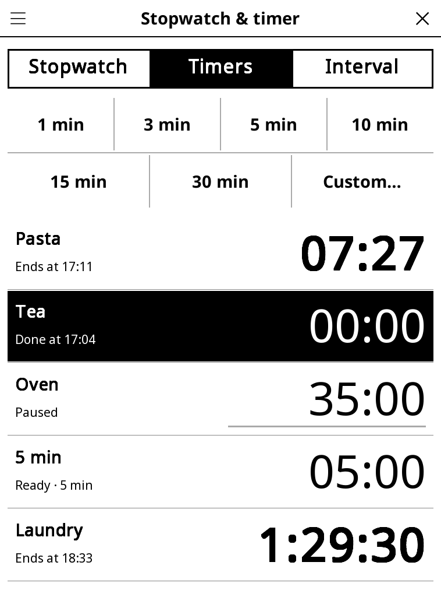

# stopwatch.koplugin

A stopwatch, countdown timers and an interval timer for [KOReader](https://github.com/koreader/koreader).
French name: *Chronomètre et minuteur*.

## Screenshot

## Features

- **Stopwatch** — start, pause, laps, reset. Each lap shows its own time and
  the total; the fastest and slowest laps are marked. Tenths of a second
  appear once paused; *All laps* (☰ menu) lists every lap.
- **Timers** — tap 1, 3, 5, 10, 15 or 30 min to start a timer at once, or
  *Custom…* to type a duration (`5` = 5 min, `1:30`, `1h30`, `90s`) and a
  name ("Kitchen"). Up to 8 timers run side by side; each row shows when it
  ends. Tap a timer to pause/resume it, hold it to restart, rename or delete.
- **Interval** — work time, rest time, rounds and a short *get ready*
  countdown. The phase (WORK in black, rest in white) and its countdown fill
  the screen.
- **Keeps running in the background** — close the screen and go back to your
  book: the timers still ring, wherever you are in KOReader.

## When time is up

A Kobo has no speaker, so:

1. the screen flashes black and white a few times (3 by default, ☰ →
   *Screen flashes*), with the frontlight blinking in step if the reader has
   one (☰ → *Frontlight blink*);
2. a message stays on screen until you tap it.

An interval workout flashes once at each change between work and rest, and
fully at the end. ☰ → *Test the alert* shows what it looks like.

## Sleep and accuracy

- Times are computed from the reader's clock, never by counting seconds, so
  they stay right whatever happens to the display.
- While a timer or the interval timer runs (or the stopwatch, while its
  screen is open), the reader is kept from suspending on its own — the same
  switches Plugin Manager uses during installs (autosuspend pause +
  standby prevention). It goes back to normal as soon as nothing runs.
  ☰ → *Keep reader awake* turns this off.
- If the reader was put to sleep anyway (power button, sleep cover), it
  tells you on waking what finished while it slept, and at what time.
- Timers are saved with their end time, so they also survive a restart of
  KOReader.

## E-ink

Only the digits are redrawn, at most once a second, with a fast partial
refresh; whole seconds only while running.

## Where to find it

Tools → Stopwatch & timer.

## License

GPL-3.0
